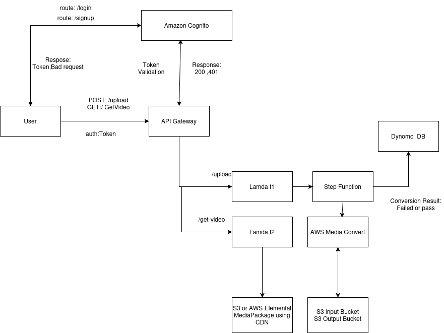
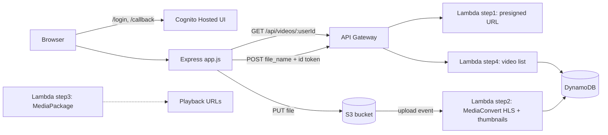

# AWS-Node-Cognito-template-OpenID-connect

  

An Express web app ("VideoHub") that signs users in with AWS Cognito (OpenID Connect), uploads videos through an API Gateway + presigned S3 URL flow, and plays back HLS streams produced by a set of AWS Lambda functions.

## Architecture



Flow as implemented in the code:



The Lambda sources are in [`lamda_function/`](./lamda_function) (see its [README](./lamda_function/README.md)). The API Gateway, S3, DynamoDB, MediaConvert and MediaPackage resources themselves are not defined in this repository (TODO: add IaC or setup steps).

## Prerequisites

- Node.js (the supported version is not pinned in `package.json`; TODO) and npm
- An AWS account with a Cognito User Pool and app client (with client secret), S3 bucket, MediaConvert, MediaPackage, DynamoDB, Lambda and API Gateway, as used by the Lambda functions

## Quick start

```bash
git clone https://github.com/umesh-khatiwada/AWS-Node-Cognito-template-OpenID-connect.git
cd AWS-Node-Cognito-template-OpenID-connect
npm install
cp .env.example .env   # then fill in your own values
npm start              # or: npm run dev (nodemon)
```

The server listens on `PORT` (default 3000). Add `<REDIRECT_UR>/callback` as an allowed callback URL, and `<REDIRECT_UR>` as a sign-out URL, in your Cognito app client.

## Configuration

Variables read by `app.js`. Never commit real values; `.env` is git-ignored.

| Variable | Description |
|----------|-------------|
| `AWS_ACCESS_KEY_ID` / `AWS_SECRET_ACCESS_KEY` | Credentials for the S3 client created in `app.js` |
| `AWS_REGION` | AWS region; also used to build the Cognito issuer URL |
| `COGNITO_USER_POOL_ID` | Cognito User Pool ID |
| `COGNITO_CLIENT_ID` / `COGNITO_CLIENT_SECRET` | Cognito app client credentials |
| `COGNITO_DOMAIN` | Cognito hosted UI domain, including `https://` |
| `SESSION_SECRET` | Secret for `express-session` |
| `API_GATEWAY_URL` | API Gateway endpoint that returns the presigned upload URL |
| `REDIRECT_UR` | App base URL used for the OAuth redirect (`/callback`) and logout. Spelled `REDIRECT_UR` (no trailing `L`) in the code and in `.env.example` |
| `PORT` | HTTP port, default `3000` |

Lambda environment variables documented for step 1: `BUCKET_NAME`, `AWS_REGION`.

> Note: `app.js` also contains a hardcoded API Gateway URL for the video list and post-upload metadata calls. Move it into configuration before reusing this template.

## Usage

| Route | Description |
|-------|-------------|
| `GET /` | Home page |
| `GET /login`, `GET /callback`, `GET /logout` | Cognito sign-in flow |
| `GET /upload` | Upload page (requires login) |
| `POST /api/presigned-url` | Receives a file, obtains a presigned URL via API Gateway and uploads to S3 |
| `GET /api/videos/:userId` | Lists the user's videos via API Gateway |
| `GET /player?url=...&title=...` | Video.js HLS player page (requires login) |

## Project structure

```
.
├── app.js                 # Express server, Cognito OIDC, upload and list routes
├── views/                 # EJS templates (home, upload, video-player, error)
├── public/                # CSS and client JS
├── lamda_function/        # step1..step4 Python Lambda functions + README
├── assets/                # architecture diagram
├── uploads/               # temporary multer upload directory
└── .env.example
```

## Troubleshooting

- Token request fails with 401: check the client ID/secret and that `COGNITO_DOMAIN` includes `https://`.
- `redirect_mismatch` from Cognito: the callback URL must exactly match `<REDIRECT_UR>/callback` in the app client.

## License

Released under the [MIT License](./LICENSE).

## Author

Umesh Khatiwada, https://github.com/umesh-khatiwada
